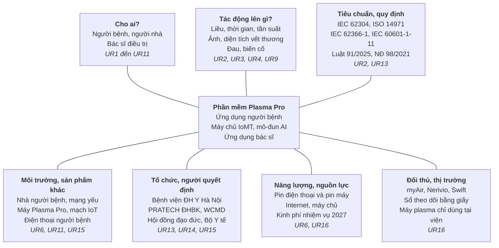

# Bước 3. User requirements

Bản nháp có 17 UR (UR17 thêm ngày 11/11/2026; UR3, UR10 đổi người dùng và mức theo quy trình 9 giai đoạn), viết từ trên cương vị người dùng theo 5W1H [1, slide 16]. Đây là giả thuyết của hệ thống: cần hỏi ít nhất một bác sĩ và một người bệnh mẫu trước khi chốt, dùng ảnh demo vòng cũ làm vật mẫu khi hỏi.

Sơ đồ bạch tuộc 7 nhánh ở cuối mục này.

| Mã | Ai | Người dùng cần | Khi nào, ở đâu | Tại sao | Mức |
|---|---|---|---|---|---|
| UR1 | Người bệnh, người nhà | Dùng máy Plasma Pro trị liệu tại nhà: biết hôm nay có phải chiếu không, chiếu vết thương nào, bao lâu, mà không cần hiểu kỹ thuật | Mỗi ngày điều trị, tại nhà | Liệu trình đi theo đợt, dày rồi thưa; người cao tuổi dễ nhầm | Must |
| UR2 | Người bệnh, người nhà | Máy chỉ phát đúng liều bác sĩ đặt; trẻ em hay người khác không tự phát được | Mọi lúc máy ở nhà | Quá liều gây stress oxy hóa [3, mục 1.1] | Must |
| UR3 | Bác sĩ | Chụp hoặc tải ảnh đúng vết thương, ảnh đủ rõ để đo và gán nhãn | Khi khám hoặc theo mốc hẹn | Bác sĩ là người thu thập dữ liệu ảnh (quy trình 9 giai đoạn, giai đoạn 7) | Must |
| UR4 | Người bệnh, người nhà | Báo đau hoặc bất thường và biết phải làm gì tiếp | Ngay khi xảy ra | An toàn; ghi biến cố cho nghiên cứu [3, mục 4.5] | Must |
| UR5 | Người bệnh | Thấy vết thương đang tiến triển | Hằng tuần | Giữ động lực tuân thủ | Nice |
| UR6 | Người bệnh | Dùng được khi mạng yếu hoặc mất, không mất dữ liệu | Tại nhà, nông thôn | Người bệnh ở xa viện | Must |
| UR7 | Bác sĩ | Đặt và đổi liệu trình cho từng vết thương từ xa | Khi khám và khi xem dữ liệu | Điều chỉnh theo diễn biến [3, mục 2] | Must |
| UR8 | Bác sĩ | Nhìn một màn biết ai cần chú ý; phân biệt "chưa có dữ liệu" với "không dùng" | Đầu ca, giữa các ca khám | Ít thời gian, nhiều người bệnh | Must |
| UR9 | Bác sĩ | Xem diện tích vết thương theo thời gian, có AI đo hộ và được sửa kết quả | Khi xem hồ sơ | Đo tay chậm; AI chỉ hỗ trợ [3, mục 5.3] | Must |
| UR10 | Bác sĩ | Xuất bộ dữ liệu ảnh có nhãn, đã giả danh hóa, phục vụ huấn luyện AI sau này | Theo mốc thu thập | Phạm vi "thu thập và gán nhãn hình ảnh" | Must |
| UR11 | Bác sĩ | Giao máy và đầu phát đúng người, nạp liệu trình qua USB, thu hồi | Khi nhập viện, xuất viện, kết thúc đợt | Đầu phát dùng riêng từng người [2, slide 25] | Must |
| UR12 | WCMD (ngoài ứng dụng) | Biết máy nào ở đâu, dùng bao nhiêu, cần bảo dưỡng | Suốt vòng đời máy cho thuê | Máy cho thuê [2, slide 24] | Ngoài phạm vi |
| UR13 | Bệnh viện, pháp chế | Dữ liệu cá nhân và ảnh được bảo vệ theo luật; người bệnh đồng ý | Suốt nghiên cứu | Luật 91/2025/QH15; hội đồng đạo đức [5] | Must |
| UR14 | Nhóm nghiên cứu | Dữ liệu thiết bị, ảnh, lâm sàng liên kết theo từng người, từng phiên, truy xuất được | Suốt thử nghiệm 30 người | Chỉ tiêu khả thi của đề cương [3, mục 4.7] | Must |
| UR15 | PRATECH, WCMD | Phần mềm không phải viết lại khi bo mạch đổi | Trong 2027 và khi chuyển giao VNPT Tech | Bo mạch chưa chốt [3, mục 3] | Must |
| UR17 | Bác sĩ | Gán nhãn ảnh theo bộ quy tắc thống nhất, sửa nhãn có lưu vết (việc duyệt nhãn nằm ngoài phạm vi đề tài) | Sau khi chụp, trước khi xuất | Bộ dữ liệu huấn luyện cần nhãn tin cậy | Must |
| UR16 | WCMD, bệnh viện | Triển khai rộng với chi phí vận hành thấp | Sau nhiệm vụ | Thương mại hóa [3, mục 5.7] | Nice |

Bộ vai trò đã chốt (11/11/2026): chỉ có **bác sĩ** và **người bệnh**. Báo cáo giữa kỳ có quản trị viên [4, mục 2.1.3] và vòng cũ có kỹ thuật viên [5]; việc của hai vai trò này (giao máy, nạp liệu trình, thu hồi) chuyển cho bác sĩ, còn theo dõi vòng đời máy (UR12) nằm ngoài ứng dụng.

*Sơ đồ bạch tuộc 7 nhánh theo slide 17 [1]; dòng cuối mỗi ô là UR liên quan.*

Mỗi UR trong bảng trên nằm trên ít nhất một nhánh; nhánh “Cho ai” sinh ra nhiều UR nhất, nhánh tiêu chuẩn và tổ chức sinh ra các UR bắt buộc không đến từ người dùng trực tiếp.
