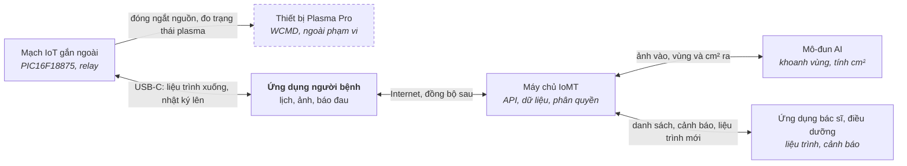

# Bước 6. Solutions generation (slide 27)

Phương án đề xuất: giữ mạch USB của báo cáo giữa kỳ nhưng thêm nhật ký phiên, ứng dụng React Native, máy chủ IoMT đặt tại hạ tầng pháp chế cho phép, AI chạy phía máy chủ. Slide 27 [1] chia bước này thành 4 việc và kết thúc bằng sơ đồ khối cấp 1.

Trên sơ đồ slide 27, Solutions generation nằm trước ô quyết định “conceptual design Verif/validation”. Nếu không đạt, quy trình quay lại UR hoặc FR. Vì vậy các lựa chọn dưới đây còn có thể đổi sau bước 8.

**6.1. Đi từ FR bắt buộc.** Bốn chức năng lõi: kiểm soát liều trên máy (FR2), thu dữ liệu phiên (FR4), ảnh và AI (FR5, FR11), bác sĩ giám sát và đổi liệu trình (FR9, FR10).

**6.2. Tìm giải pháp công nghệ lõi.** Nguồn: sản phẩm tương tự [5], báo cáo giữa kỳ [4], brainstorming. Mỗi chức năng có 2 đến 3 phương án:

| Chức năng lõi | Phương án | Đáp ứng | Rủi ro chính | Đề xuất |
|---|---|---|---|---|
| Kết nối máy và điện thoại | S1. USB-UART, nạp trước phiên (giữa kỳ) | FR2; FR4 nếu thêm nhật ký phiên | Người bệnh phải cắm cáp; dữ liệu chậm 1 phiên | **Chọn**, kèm nhật ký phiên |
|  | S2. BLE | FR2, FR4 gần thời gian thực | Thêm vô tuyến: nhiễu EMI, phải thử lại IEC 60601-1-2, tốn pin | Dự phòng cho bản sau |
|  | S3. Wi-Fi hoặc 4G lên máy chủ | FR4 không cần điện thoại | Chi phí, pin, cấu hình mạng khó cho người cao tuổi | Loại |
| Ứng dụng di động | A1. React Native/Expo (prototype vòng cũ) | Android và iOS một mã | Cần thư viện USB gốc cho Android | **Chọn** nếu giảng viên đồng ý |
|  | A2. Kotlin gốc | USB, BLE ổn định nhất | Chỉ Android; viết lại từ đầu | Thay thế |
| Máy chủ IoMT | B1. Firebase (báo cáo giữa kỳ nhắc “Security Rules”) | Nhanh | Máy chủ ở nước ngoài, vướng NFR6 | Chỉ để thử |
|  | B2. API và cơ sở dữ liệu tự dựng trên hạ tầng trong nước | NFR1, NFR6 | Tự vận hành | **Chọn** |
| AI đo diện tích | C1. Phân vùng ảnh trên máy chủ | Mô hình lớn được, dễ cập nhật | Ảnh phải rời điện thoại | **Chọn** |
|  | C2. Phân vùng trên điện thoại | Ảnh không rời máy | Máy yếu chạy chậm, khó cập nhật mô hình | Thay thế nếu pháp chế cấm đưa ảnh lên |

**6.3. Tích hợp nhu cầu phi chức năng bắt buộc.** NFR3 (hợp đồng thiết bị) cho phép đổi S1 sang S2 sau này mà không viết lại ứng dụng. NFR1 và NFR6 quyết định B2 thay vì B1. NFR5 và phân quyền phía máy chủ xử lý hai lỗi đã gặp ở vòng cũ [5].

**6.4. Sàng lọc phần còn lại theo ưu tiên.** Thứ tự đề xuất cho nice to have: FR12 xuất phiếu (giúp nghiên cứu ngay năm 2027), rồi FR7, FR14, NFR7 (phục vụ thương mại hóa sau nhiệm vụ).

**6.5. Sơ đồ khối cấp 1** (bên dưới): 6 khối, ranh giới giữa phần của WCMD và phần của PRATECH.

*Sơ đồ khối cấp 1, phương án S1 + A1 + B2 + C1. Ứng dụng người bệnh là cầu nối duy nhất giữa máy và máy chủ.*

Máy không nối thẳng lên máy chủ: liệu trình mới và nhật ký phiên đều đi qua điện thoại người bệnh, nên dữ liệu chậm tối đa một lần cắm cáp. Khối nét đứt thuộc WCMD, ngoài phạm vi đồ án.
