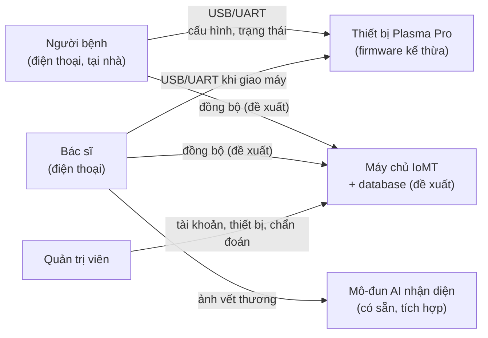
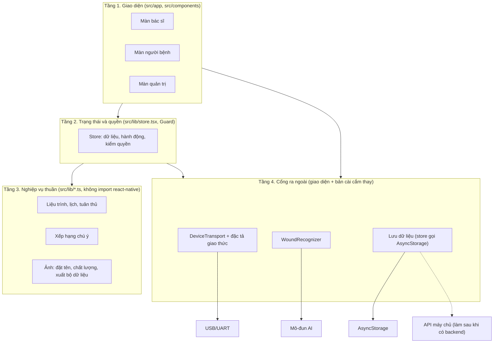
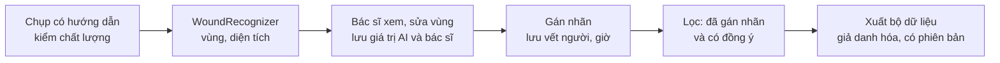

# Thiết kế kiến trúc tổng thể ứng dụng Plasma Pro

**Trạng thái:** bản nháp ngày 11/11/2026. Đây là phần "Thiết kế kiến trúc tổng thể" trong quy trình 9 giai đoạn của chủ đồ án, ứng với bước 10 (Detailed design) của khung 15 bước [1, slide 12]. Đầu vào là TR1 đến TR13 ở [07-thiet-ke-cau-truc.md](07-thiet-ke-cau-truc.md) và NFR1 đến NFR7 ở [05-nhu-cau-tinh-nang.md](05-nhu-cau-tinh-nang.md). Bước 8 (kiểm chứng với người dùng thật) chưa làm, nên các quyết định dưới đây có thể đổi sau bước 8.

Ký hiệu trạng thái dùng trong tài liệu:

- **Có sẵn:** đã có trong mã của prototype (nhánh `nang-cap/sdk-58`).
- **GĐ1:** sẽ làm theo kế hoạch `plans/2026-11-11_ung-dung-giai-doan-1.md`.
- **GĐ sau:** lập trình ở giai đoạn sau, chờ câu trả lời của bên khác.
- **Đề xuất:** chỉ thiết kế, không lập trình (theo bảng phạm vi ở [00-pham-vi-va-gia-dinh.md](00-pham-vi-va-gia-dinh.md)).

## 1. Bối cảnh hệ thống



Ba vai trò dùng chung một ứng dụng, phân màn theo vai trò: bác sĩ là người dùng chính, người bệnh dùng ứng dụng để trị liệu tại nhà, quản trị viên quản lý tài khoản và thiết bị. Không có vai trò điều dưỡng.

**Giới hạn quan trọng:** liệu trình do bác sĩ soạn trên điện thoại bác sĩ chỉ đến được điện thoại người bệnh khi có máy chủ. Máy chủ chỉ là đề xuất, nên bản lập trình của đề tài chạy trên dữ liệu cục bộ của một điện thoại (bản demo đăng nhập lần lượt từng vai trò trên cùng máy). Chủ đồ án đã chốt giữ demo một máy, xử lý đồng bộ khi có backend và database (mục 4, KT1).

## 2. Nền tảng

| Mục | Lựa chọn | Nguồn hoặc lý do |
|---|---|---|
| Khung ứng dụng | Expo SDK 58 (`expo ~58.0.22`), React Native 0.88.1, React 19.3, TypeScript | `package.json` của repo |
| Điều hướng | Expo Router, mỗi tệp trong `src/app/` là một màn | `AGENTS.md` của repo |
| Lưu cục bộ | AsyncStorage, khóa `plasmapro.demo.v2`; ảnh lưu bằng `expo-file-system` | `src/lib/store.tsx` |
| Camera, ảnh | `expo-camera`, `expo-image-picker`, `expo-image-manipulator` | `package.json` |
| Thông báo nhắc lịch | `expo-notifications` | `package.json`, `src/lib/reminders.ts` |
| USB trên Android | Mô-đun gốc dùng USB Host API, cần development build (Expo Go chỉ có mô-đun gốc đóng sẵn) | `AGENTS.md`; chưa tra tài liệu Expo SDK 58, độ tin cậy trung bình |
| USB trên iOS | Chưa chọn; CP2102N không có trình điều khiển cho iOS [2] | Câu F4 trong [icd-usb-uart.md](icd-usb-uart.md) |

## 3. Các tầng của ứng dụng



Quy tắc phụ thuộc:

1. Tầng trên được gọi tầng dưới, không ngược lại.
2. Tầng 3 là TypeScript thuần, kiểm thử bằng `node` không cần điện thoại, đúng cách repo đang làm (`npm test`).
3. Thiết bị và mô-đun AI chỉ được chạm qua một giao diện ở tầng 4; nơi lưu dữ liệu tạm do store gọi thẳng cho đến khi có backend (KT1). Mỗi giao diện có ít nhất một bản cài giả để chạy và kiểm thử khi chưa có thứ thật. Đây là cách đáp ứng NFR3.

## 4. Quyết định kiến trúc

| Mã | Quyết định | Lý do | Hệ quả | Trạng thái |
|---|---|---|---|---|
| KT1 | Dữ liệu nằm trên một máy; luồng bác sĩ gửi liệu trình cho người bệnh chạy dạng demo trong ứng dụng, đăng nhập lần lượt hai vai trò trên cùng máy | Chủ đồ án chốt ngày 11/11/2026: "tạo 1 demo gửi luồng trong sản phẩm này thôi, khi nào có backend và database sẽ xử lý sau" | Không thêm mã đồng bộ; Chương 4 ghi rõ luồng giữa hai điện thoại chỉ là mô phỏng; nối máy chủ là việc sau khi có backend, database | Đã chốt |
| KT2 | Giao tiếp thiết bị qua `DeviceTransport` chỉ chuyển byte, định dạng nằm trong đặc tả khai báo | Firmware chưa chốt | Firmware chốt thì sửa dữ liệu, không sửa mã; giả lập nói theo cùng đặc tả | GĐ1 (giả lập), GĐ sau (USB thật) |
| KT3 | Nhận diện vết thương qua `WoundRecognizer` | Chưa biết dạng mô-đun AI có sẵn | Đổi mô-đun không sửa màn chụp; giai đoạn 1 dùng bộ dò màu hiện có làm bản cài tạm | GĐ1 |
| KT4 | Kiểm quyền ở store (ứng dụng); khi có máy chủ thì kiểm lại ở máy chủ | NFR1 đòi kiểm ở máy chủ, nhưng máy chủ chỉ đề xuất | Bản lập trình chỉ đáp ứng một phần NFR1; ghi rõ trong Chương 4 | Có sẵn (ứng dụng), Đề xuất (máy chủ) |
| KT5 | Ứng dụng không tự đặt giá trị điều trị | An toàn người bệnh; giá trị do bác sĩ quyết định | Mức và chế độ chỉ chọn trong năng lực máy; không có mặc định | GĐ1 |
| KT6 | Mọi mốc "hôm nay" và đồng hồ gửi máy tính theo UTC+7 | NFR5 | Dùng `localDay` và `deviceClock`, không dùng múi giờ của điện thoại | Có sẵn (`localDay`), GĐ1 (`deviceClock`) |
| KT7 | Một ứng dụng cho ba vai trò, chia màn theo vai trò | Người dùng giữ vai trò admin; ít mã trùng | Quản trị viên không xem dữ liệu lâm sàng (`useCanView`) | Có sẵn |

## 5. Mô-đun và trách nhiệm

| Mô-đun | Tệp chính | Trách nhiệm | TR, FR | Trạng thái |
|---|---|---|---|---|
| Xác thực, vai trò | `src/lib/auth.ts`, `src/components/Guard.tsx`, `src/app/register.tsx`, `activate.tsx` | Đăng nhập, kích hoạt tài khoản người bệnh, kiểm quyền xem hồ sơ | TR7 (phía ứng dụng), NFR1 | Có sẵn |
| Store | `src/lib/store.tsx`, `src/lib/types.ts`, `src/lib/seed.ts` | Dữ liệu ứng dụng, hành động có kiểm quyền, lưu cục bộ | TR5 | Có sẵn; thêm nhật ký gửi máy ở GĐ1 |
| Liệu trình và lịch | `src/lib/course.ts`, `adherence.ts`, `reminders.ts`, `src/app/plan/[patientId].tsx`, `schedule.tsx` | Soạn liệu trình theo vết thương có phiên bản, lịch hôm nay, nhắc lịch | TR6, TR11, FR1, FR9 | Có sẵn; thêm chế độ điều trị ở GĐ1 |
| Lớp thiết bị | `src/lib/device/*` | Đặc tả giao thức, mã hóa khung, gửi có xác nhận, hỏi máy, giả lập, bản ghi hex | TR3, TR4, FR2, NFR3 | GĐ1 |
| Màn thiết bị | `connect-device.tsx`, `session-monitor.tsx`, `device-diagnostics.tsx`, `patient/device.tsx`, `devices/[id].tsx` | Nạp liệu trình xuống máy, theo dõi phiên, chẩn đoán | FR2, FR13 | GĐ1 (màn mới), Có sẵn (màn cũ) |
| Ảnh và nhận diện | `src/lib/capture/*`, `src/lib/ai/*`, `guided-capture.tsx`, `capture.tsx`, `images/[id].tsx` | Chụp có hướng dẫn, kiểm chất lượng, nhận diện, diện tích | TR10, TR13, FR5, FR11 | Có sẵn; tách `src/lib/ai/` ở GĐ1 |
| Gán nhãn và bộ dữ liệu | `src/lib/naming.ts`, `research.ts`, `export.ts`, `doctor/dataset.tsx`, `admin/dataset.tsx` | Đặt tên ảnh, lưu vết nhãn, xuất bộ dữ liệu giả danh hóa | TR13, FR12, FR15 đến FR17 | Có sẵn một phần; màn gán nhãn theo phương pháp bác sĩ chọn là GĐ sau |
| Tổng quan bác sĩ | `src/lib/attention.ts`, `doctor/index.tsx` | Xếp người bệnh theo mức cần chú ý, trạng thái hôm nay | TR12, FR10 | GĐ1 |
| Triệu chứng | `report.tsx`, `patient/index.tsx`, hành động trong store | Báo đau, biến cố | FR6 | Có sẵn |
| Báo cáo in | `src/lib/report.ts` | Xuất báo cáo diễn biến dạng PDF | FR7 | Có sẵn |
| Đồng bộ với máy chủ | chưa có | Đẩy, kéo dữ liệu giữa các điện thoại | KT1, TR5, FR8 | Làm khi có backend, database |
| Máy chủ IoMT, database | tài liệu riêng | API, xác thực, kiểm quyền, nhật ký kiểm toán, mô hình dữ liệu | TR7, TR8, TR9 | Đề xuất |

## 6. Luồng dữ liệu chính

### 6.1. Bác sĩ đặt liệu trình, người bệnh nạp xuống máy tại nhà

```mermaid
sequenceDiagram
  participant BS as Bác sĩ (ứng dụng)
  participant KHO as Dữ liệu trên máy
  participant BN as Người bệnh (ứng dụng)
  participant MAY as Plasma Pro
  BS->>KHO: Lưu liệu trình "Đang áp dụng" (mức, chế độ, thời gian, đã xác nhận)
  KHO-->>BN: Liệu trình mới (demo: cùng máy; sau này: qua máy chủ)
  BN->>MAY: Cắm USB, INF và CAP (hỏi phiên bản, năng lực)
  MAY-->>BN: INF, CAP (hoặc không trả lời: dùng bảng dự phòng)
  BN->>BN: Kiểm cấu hình theo năng lực máy
  BN->>MAY: CFG (10 trường)
  MAY-->>BN: ACK hoặc NAK (hết giờ thì gửi lại, tối đa 2 lần)
  BN->>KHO: Ghi nhật ký gửi (kết quả, số lần, phiên bản giao thức)
  MAY-->>BN: STA mỗi giây khi phiên chạy
```

### 6.2. Ảnh vết thương đến bộ dữ liệu



### 6.3. Phiên điều trị đến tổng quan bác sĩ

Phiên kết thúc trên máy, ứng dụng người bệnh nhận `STA` `done`, ghi phiên vào kho. Màn tổng quan bác sĩ đọc phiên, lịch và báo cáo triệu chứng, tính trạng thái hôm nay (đã chiếu, cần chiếu, chưa có dữ liệu, ngày nghỉ, chưa có đợt) và điểm cần chú ý. Khi chưa có máy chủ, luồng này chỉ chạy trọn vẹn trong bản demo một máy. Đọc nhật ký phiên từ chính thiết bị (FR4) chờ câu F11 của ICD.

## 7. Đối chiếu TR với mô-đun

| TR | Mô-đun đáp ứng | Mức trong đề tài |
|---|---|---|
| TR1, TR2 | Firmware | Yêu cầu gửi nhóm phần cứng |
| TR3 | Lớp thiết bị (phía ứng dụng), ICD | Lập trình phía ứng dụng |
| TR4 | `DeviceTransport`, thiết bị giả lập | Lập trình |
| TR5 | Store | Lập trình phần cục bộ; đồng bộ làm sau |
| TR6 | Màn chính người bệnh | Lập trình |
| TR7, TR8, TR9 | Máy chủ, database | Đề xuất |
| TR10 | `src/lib/ai/` | Tích hợp |
| TR11 | Màn soạn liệu trình, bảng năng lực | Lập trình |
| TR12 | Tổng quan bác sĩ | Lập trình |
| TR13 | Ảnh, gán nhãn, bộ dữ liệu | Lập trình |

Mọi TR đều có mô-đun nhận. TR1 và TR2 nằm ngoài ứng dụng.

## 8. Câu hỏi mở ảnh hưởng kiến trúc

1. Mô-đun AI chạy trên điện thoại hay trên máy chủ. Nếu chạy trên máy chủ, bản tích hợp phụ thuộc máy chủ đề xuất, nên đề tài chỉ cài được bản giả.
2. Bộ chuyển USB cho iPhone (câu F4 của ICD).

## Tài liệu tham khảo

[1] Lương Thị Hồng Liên, "Phương pháp luận thiết kế, phần 1", bài giảng, 10/04/2026, slide 12.

[2] Silicon Labs, "CP210x USB to UART Bridge VCP Drivers". https://www.silabs.com/developers/usb-to-uart-bridge-vcp-drivers (truy cập 11/11/2026).
