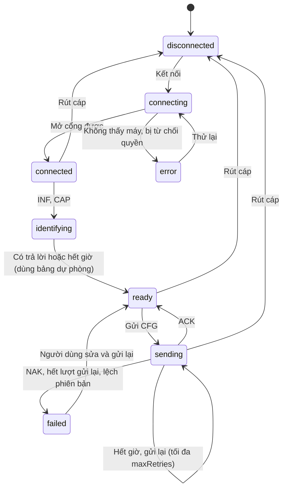
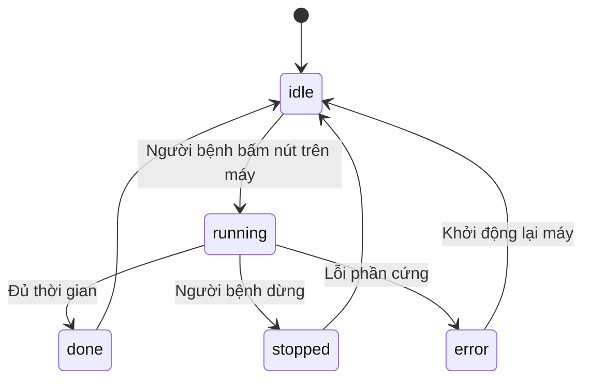

# Bước 10. Detailed design

Trạng thái: **bản nháp chờ validation**. Bước này gồm bốn phần; ba phần đã có tệp riêng, tệp này bổ sung phần còn thiếu và trỏ tới các tệp kia.

| Phần | Tệp |
|---|---|
| Kiến trúc tầng, quyết định kiến trúc, mô-đun | [10-kien-truc-tong-the.md](10-kien-truc-tong-the.md) |
| Giao thức USB/UART | [icd-usb-uart.md](icd-usb-uart.md) |
| Mô hình dữ liệu (đề xuất) | [de-xuat-co-so-du-lieu.md](de-xuat-co-so-du-lieu.md) |
| Máy trạng thái, danh sách màn | Tệp này |

## 10.1. Máy trạng thái kết nối và gửi cấu hình

Theo `src/lib/device/transport.ts` và `sender.ts` (giai đoạn 1).

`identifying`, `ready`, `sending`, `failed` là trạng thái của màn kết nối; `DeviceTransport` chỉ có bốn trạng thái `disconnected`, `connecting`, `connected`, `error`.

## 10.2. Máy trạng thái phiên điều trị

Theo bản tin `STA` và `statusStates` trong `protocol.config.ts`. Máy chủ động chuyển trạng thái; ứng dụng chỉ hiển thị. Các sự kiện chuyển trạng thái (nút bấm trên máy, cách dừng) là giả định, chờ nhóm firmware xác nhận ICD.

Khi màn theo dõi phiên nhận `done`, ứng dụng ghi một phiên điều trị. Phiên ghi từ `STA` chỉ có thời điểm và thời gian; mức, chế độ thực phát chờ nhật ký phiên của firmware (câu F11 của ICD).

## 10.3. Danh sách màn theo vai trò

| Vai trò | Màn | Tệp | FR |
|---|---|---|---|
| Chung | Đăng nhập, kích hoạt, điều khoản, hướng dẫn lần đầu | `index.tsx`, `activate.tsx`, `terms.tsx`, `onboarding.tsx` | NFR1 |
| Bác sĩ | Tổng quan | `doctor/index.tsx` | FR10 |
| Bác sĩ | Danh sách, hồ sơ, tạo người bệnh | `doctor/patients.tsx`, `patients/[id].tsx`, `patients/new.tsx` | FR9 |
| Bác sĩ | Vết thương, so sánh ảnh, đánh giá | `wounds/[id].tsx`, `compare/[woundId].tsx`, `evaluate/[woundId].tsx` | FR7 |
| Bác sĩ | Soạn liệu trình | `plan/[patientId].tsx` | FR9 |
| Bác sĩ | Chụp có hướng dẫn, tải ảnh, chi tiết ảnh | `guided-capture.tsx`, `capture.tsx`, `images/[id].tsx` | FR5, FR11, FR15 |
| Bác sĩ | Bộ dữ liệu | `doctor/dataset.tsx` | FR12, FR17 |
| Bác sĩ, người bệnh | Kết nối máy và nạp liệu trình | `connect-device.tsx` | FR2 |
| Bác sĩ, người bệnh | Theo dõi phiên | `session-monitor.tsx` | FR2, FR4 |
| Người bệnh | Hôm nay, lịch sử, thiết bị, gửi ảnh, báo đau, lịch | `patient/index.tsx`, `patient/history.tsx`, `patient/device.tsx`, `patient/send.tsx`, `report.tsx`, `schedule.tsx` | FR1, FR6, FR7 |
| Quản trị | Tài khoản, thiết bị, nhật ký, bộ dữ liệu | `admin/*.tsx`, `devices/[id].tsx` | FR13, FR14 |
| Quản trị | Chẩn đoán USB/UART (hex) | `device-diagnostics.tsx` | TR3 |
