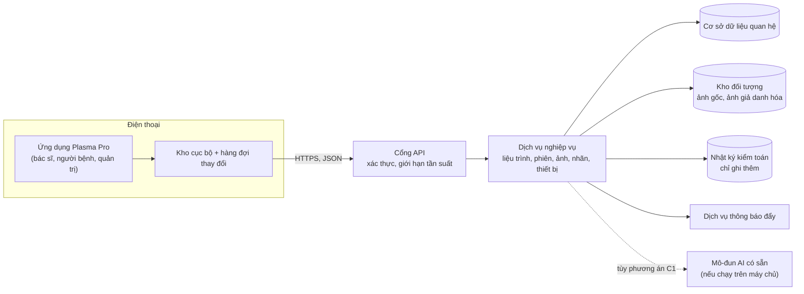

# Đề xuất backend (máy chủ IoMT)

Trạng thái: **chỉ đề xuất**, không lập trình trong đề tài (bảng phạm vi ở [00-pham-vi-va-gia-dinh.md](00-pham-vi-va-gia-dinh.md)). Tài liệu này đáp ứng phần "đề xuất kiến trúc, chức năng, phương án kết nối" và truy về TR7, TR9, phía máy chủ của TR5 ([07-thiet-ke-cau-truc.md](07-thiet-ke-cau-truc.md)). Mô hình dữ liệu nằm ở [de-xuat-co-so-du-lieu.md](de-xuat-co-so-du-lieu.md).

Ngày lập: 11/11/2026. Mọi lựa chọn công nghệ dưới đây là đề xuất của người thiết kế, chưa bàn với bệnh viện hay giảng viên.

## 1. Backend giải quyết vấn đề gì

Bản lập trình hiện tại giữ dữ liệu trong AsyncStorage của một điện thoại (KT1 trong [10-kien-truc-tong-the.md](10-kien-truc-tong-the.md)). Hệ quả:

1. Liệu trình bác sĩ soạn trên điện thoại bác sĩ không đến được điện thoại người bệnh.
2. Ảnh, phiên điều trị, báo đau của người bệnh không đến được bác sĩ, nên FR6 (báo bác sĩ trong 15 phút) và FR10 (tổng quan bác sĩ) chỉ chạy trong demo một máy.
3. Phân quyền chỉ kiểm ở ứng dụng; NFR1 đòi kiểm ở máy chủ (KT4).
4. Bộ dữ liệu ảnh (FR12) chỉ gom được từ một máy.

Backend là nơi chung cho ba vai trò, kiểm quyền lần cuối, và giữ nhật ký kiểm toán.

## 2. Kiến trúc đề xuất

| Thành phần | Trách nhiệm | Đề xuất công nghệ | Lý do |
|---|---|---|---|
| Cổng API | TLS, xác thực token, giới hạn tần suất, ghi truy cập | Reverse proxy (ví dụ Nginx) trước dịch vụ | Tách phần bảo mật đường truyền khỏi nghiệp vụ |
| Dịch vụ nghiệp vụ | Một khối (monolith) chia mô-đun theo bảng mục 3 | Node.js với TypeScript | Dùng lại kiểu `src/lib/types.ts` và hàm thuần (`course.ts`, `adherence.ts`, `attention.ts`) của ứng dụng; một người duy trì được |
| Cơ sở dữ liệu | Dữ liệu có cấu trúc, quan hệ, ràng buộc | PostgreSQL | Có ràng buộc khóa ngoại, giao dịch, kiểu JSON cho siêu dữ liệu ảnh |
| Kho đối tượng | Tệp ảnh, tệp xuất bộ dữ liệu | Kho tương thích S3, đặt trong hạ tầng bệnh viện | Ảnh lớn không nên nằm trong bảng; NFR6 đòi hạ tầng pháp chế cho phép |
| Thông báo đẩy | Báo bác sĩ khi người bệnh báo đau vượt ngưỡng (FR6), nhắc lịch | Dịch vụ đẩy của nền tảng qua `expo-notifications` | Ứng dụng đã dùng `expo-notifications` |

Chọn một khối thay vì vi dịch vụ: số người dùng của đề cương là 30 người bệnh năm 2027 [3, mục 4.7], nên chi phí vận hành nhiều dịch vụ không đáng. Đây là suy luận, độ tin cậy trung bình.

## 3. Chức năng và điểm cuối API

Quy ước: tiền tố `/api/v1`, JSON, thời gian ISO 8601 có múi giờ, mốc "hôm nay" tính theo UTC+7 ở máy chủ (NFR5, TR9). Cột "Ai gọi" là vai trò được phép; máy chủ kiểm thêm quan hệ (bác sĩ chỉ thấy người bệnh mình phụ trách, người bệnh chỉ thấy hồ sơ mình).

| Nhóm | Điểm cuối | Ai gọi | FR |
|---|---|---|---|
| Xác thực | `POST /auth/login`, `POST /auth/refresh`, `POST /auth/logout` | Mọi vai trò | NFR1 |
| | `POST /auth/activate` (mã kích hoạt một lần do bác sĩ cấp) | Người bệnh | NFR1 |
| Người bệnh | `GET /patients`, `POST /patients`, `GET /patients/{id}`, `PATCH /patients/{id}` | Bác sĩ (của mình); người bệnh chỉ `GET` bản thân | FR9 |
| | `POST /patients/{id}/consents` | Bác sĩ ghi, người bệnh xác nhận | FR12 |
| Vết thương | `GET /patients/{id}/wounds`, `POST /wounds`, `PATCH /wounds/{id}` | Bác sĩ | FR1, FR9 |
| Liệu trình | `GET /wounds/{id}/plans`, `POST /plans` (tạo phiên bản mới, không sửa đè) | Bác sĩ; người bệnh chỉ đọc bản "Đang áp dụng" | FR9, TR11 |
| Lịch hôm nay | `GET /me/today` | Người bệnh | FR1 |
| Phiên điều trị | `POST /sessions`, `GET /patients/{id}/sessions` | Người bệnh ghi; bác sĩ đọc | FR4 |
| Nhật ký gửi máy | `POST /device-links` | Người bệnh, bác sĩ | FR2 |
| Báo đau, biến cố | `POST /reports`, `PATCH /reports/{id}` (đánh dấu đã xử lý) | Người bệnh ghi; bác sĩ xử lý | FR6 |
| Ảnh | `POST /images` (xin URL tải lên có hạn), `PUT` tệp vào kho đối tượng, `POST /images/{id}/commit` | Bác sĩ, người bệnh | FR5 |
| | `GET /images?patient=&wound=&status=` | Bác sĩ | FR17 |
| Nhận diện | `POST /images/{id}/ai-results` (ứng dụng gửi kết quả C2) hoặc máy chủ tự chạy (C1) | Ứng dụng hoặc máy chủ | FR11 |
| Nhãn | `POST /images/{id}/annotations` (mỗi lần sửa là bản ghi mới) | Bác sĩ | FR15, FR16 |
| Bộ dữ liệu | `POST /datasets` (đóng băng phiên bản), `GET /datasets/{id}/export` | Bác sĩ có quyền nghiên cứu | FR12 |
| Tổng quan | `GET /doctor/overview` (xếp hạng mức cần chú ý, 3 trạng thái hôm nay) | Bác sĩ | FR10 |
| Thiết bị | `GET /devices`, `POST /devices/{id}/assign`, `POST /devices/{id}/return` | Quản trị, bác sĩ | FR13, FR14 |
| Đồng bộ | `POST /sync/push`, `GET /sync/pull?since=` | Mọi vai trò | FR8, TR5 |
| Kiểm toán | `GET /audit?entity=&from=&to=` | Quản trị | NFR1, TR9 |

## 4. Phương án kết nối với ứng dụng

### 4.1. Lớp kho dữ liệu trong ứng dụng

Hiện `src/lib/store.tsx` gọi thẳng AsyncStorage. Khi có backend, thêm một lớp kho (mẫu Repository [1]) giữa store và nơi lưu: bản cục bộ giữ AsyncStorage, bản đồng bộ thêm hàng đợi và gọi API. Màn hình và nghiệp vụ không đổi. Chủ đồ án đã chốt chưa làm lớp này trong đề tài (KT1); mục này chỉ mô tả cách nối sau.

### 4.2. Ngoại tuyến trước, đồng bộ sau (FR8)

Người bệnh dùng máy tại nhà, có thể mất mạng. Đề xuất:

1. Mỗi thay đổi tạo một bản ghi `{ changeId (UUID), entity, entityId, op, data, at, by }` trong hàng đợi cục bộ, đánh dấu "chưa gửi".
2. Khi có mạng, ứng dụng gửi lô qua `POST /sync/push`. Máy chủ lưu `changeId` đã nhận; gửi lại cùng `changeId` thì trả kết quả cũ, không ghi đôi (TR5: 0 bản ghi trùng). Cơ chế tương tự tiêu đề `Idempotency-Key` trong bản nháp IETF [2].
3. Ứng dụng kéo thay đổi của người khác qua `GET /sync/pull?since=<mốc máy chủ>`; mốc là số thứ tự tăng dần của máy chủ, không dùng giờ điện thoại để tránh lệch đồng hồ.
4. Tệp ảnh tải riêng sau bản ghi ảnh, có thể tiếp tục khi đứt mạng.

### 4.3. Xung đột

| Dữ liệu | Quy tắc | Lý do |
|---|---|---|
| Liệu trình | Không sửa đè: mỗi lần sửa là phiên bản mới; hai bác sĩ cùng tạo phiên bản từ cùng gốc thì máy chủ từ chối bản đến sau và yêu cầu xem lại | FR9 đòi nhật ký thay đổi; liệu trình ảnh hưởng an toàn |
| Phiên, báo đau, ảnh, nhãn | Chỉ ghi thêm, không xung đột | Mỗi bản ghi có mã riêng |
| Hồ sơ người bệnh | Trường sửa sau thắng, ghi nhật ký kiểm toán | Ít khi sửa đồng thời |

### 4.4. Liệu trình đến máy tại nhà

Người bệnh kéo liệu trình "Đang áp dụng" về điện thoại, rồi nạp xuống Plasma Pro qua USB như giai đoạn 1 ([icd-usb-uart.md](icd-usb-uart.md)). Máy chủ không nói chuyện trực tiếp với thiết bị, vì mạch giữa kỳ không có kết nối mạng (GA-2, phương án S1).

## 5. Bảo mật và pháp lý

| Yêu cầu | Đề xuất | Nguồn |
|---|---|---|
| Dữ liệu sức khỏe là dữ liệu cá nhân nhạy cảm | Thu thập tối thiểu, có đồng ý, cho người bệnh xem và yêu cầu xóa | Luật Bảo vệ dữ liệu cá nhân 91/2025/QH15 [4]; Nghị định 13/2023/NĐ-CP [5] |
| Mã hóa đường truyền | Chỉ HTTPS (TLS 1.2 trở lên) | NFR1 |
| Mã hóa khi lưu | Mã hóa ổ đĩa cơ sở dữ liệu và kho đối tượng | NFR1 |
| Xác thực | Token truy cập ngắn hạn (ví dụ 15 phút) và token làm mới; token dạng JWT [6] | NFR1 |
| Phân quyền | Kiểm theo vai trò và theo quan hệ bác sĩ, người bệnh ở mọi điểm cuối | TR7 |
| Nhật ký kiểm toán | Ghi ai, lúc nào, làm gì với bản ghi nào; bảng chỉ ghi thêm | TR9 |
| Giả danh hóa bộ dữ liệu | Thay mã người bệnh bằng mã nghiên cứu, xóa EXIF, tách kho ảnh nghiên cứu | FR12 |
| Nơi đặt máy chủ | Hạ tầng bệnh viện hoặc nhà cung cấp trong nước được bệnh viện chấp thuận | NFR6, chờ bệnh viện |

Mức tin cậy trung bình về điều khoản pháp lý cụ thể: hệ thống chưa đọc toàn văn Luật 91/2025/QH15 trong phiên này. Cần người có chuyên môn pháp lý của bệnh viện xác nhận.

## 6. Khả năng liên thông về sau

Nếu bệnh viện cần trao đổi với hệ thống bệnh án điện tử, các thực thể chính ánh xạ được sang tài nguyên HL7 FHIR R4 [7]: Patient sang `Patient`, Wound sang `Condition` hoặc `BodyStructure`, Image sang `Media`, phiên điều trị sang `Procedure`, diện tích sang `Observation`. Đây là hướng phát triển, không thuộc đề tài.

## 7. Để ngỏ

1. Nơi đặt máy chủ và ai vận hành (NFR6).
2. Mô-đun AI chạy trên máy chủ (C1) hay điện thoại (C2); ảnh hưởng điểm cuối nhận diện.
3. Ngưỡng báo đau và thời gian báo bác sĩ (FR6, đang là đề xuất 15 phút).

## Tài liệu tham khảo

[1] M. Fowler, *Patterns of Enterprise Application Architecture*, Addison-Wesley, 2002, mẫu Repository. https://martinfowler.com/eaaCatalog/repository.html

[2] J. Jena, S. Dalal, "The Idempotency-Key HTTP Header Field", IETF Internet-Draft draft-ietf-httpapi-idempotency-key-header. https://datatracker.ietf.org/doc/draft-ietf-httpapi-idempotency-key-header/ (chưa kiểm lại phiên bản và trạng thái mới nhất).

[3] Đề cương nghiên cứu Plasma Pro (bản chốt), mục 4.7 (tài liệu nội bộ người dùng gửi).

[4] Quốc hội Việt Nam, Luật Bảo vệ dữ liệu cá nhân số 91/2025/QH15, thông qua ngày 26/06/2025, hiệu lực 01/01/2026 (chưa đọc toàn văn trong phiên này).

[5] Chính phủ Việt Nam, Nghị định 13/2023/NĐ-CP về bảo vệ dữ liệu cá nhân, 17/04/2023.

[6] M. Jones, J. Bradley, N. Sakimura, "JSON Web Token (JWT)", RFC 7519, IETF, 2015. https://www.rfc-editor.org/rfc/rfc7519

[7] HL7 International, *FHIR Release 4*. https://hl7.org/fhir/R4/
