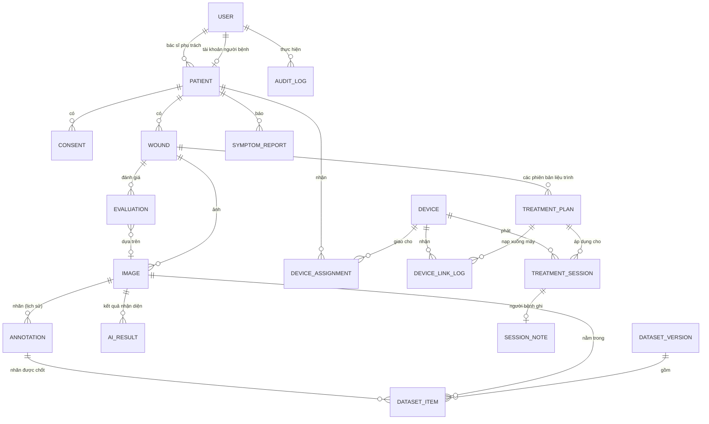

# Đề xuất mô hình dữ liệu (database)

Trạng thái: **chỉ đề xuất mô hình dữ liệu**, không lập trình (bảng phạm vi ở [00-pham-vi-va-gia-dinh.md](00-pham-vi-va-gia-dinh.md)). Truy về TR8 ([07-thiet-ke-cau-truc.md](07-thiet-ke-cau-truc.md)): "mọi phiên truy ngược được về liệu trình đã dùng". Kiến trúc máy chủ nằm ở [de-xuat-backend.md](de-xuat-backend.md).

Ngày lập: 11/11/2026. Mô hình viết cho cơ sở dữ liệu quan hệ (đề xuất PostgreSQL); tên bảng tiếng Anh để khớp mã nguồn.

## 1. Nguyên tắc

1. Mỗi bảng có khóa chính `id` dạng UUID do ứng dụng sinh, để bản ghi tạo ngoại tuyến không trùng khi đồng bộ (TR5).
2. Dữ liệu lâm sàng chỉ ghi thêm: liệu trình có phiên bản, nhãn có lịch sử, phiên không sửa. Sửa là thêm bản ghi mới.
3. Mọi bảng có `created_at`, `created_by`; bảng sửa được có thêm `updated_at`, `updated_by`.
4. Họ tên, số điện thoại chỉ nằm ở `patient`; bảng nghiên cứu dùng `research_code` (FR12).
5. Thời điểm lưu dạng `timestamptz`; mốc "ngày điều trị" lưu dạng `date` theo UTC+7 (NFR5).

## 2. Sơ đồ quan hệ

## 3. Các bảng

Ký hiệu: PK khóa chính, FK khóa ngoại, `?` cho phép rỗng.

### 3.1. Người dùng và người bệnh

| Bảng | Trường chính | Ràng buộc | Kiểu trong ứng dụng |
|---|---|---|---|
| `user` | `id` PK, `role` (`doctor`, `patient`, `admin`), `username` duy nhất, `name`, `title?`, `password_hash`, `locked`, `research_access`, `terms_version?`, `terms_accepted_at?` | `role` thuộc 3 giá trị; người bệnh phải có `patient_id` | `Account` |
| `patient` | `id` PK, `code` duy nhất (BN001), `research_code?` duy nhất, `name`, `birth_year`, `sex`, `phone`, `doctor_id` FK `user`, `user_id?` FK `user` | `doctor_id` phải là người dùng vai trò `doctor` | `Patient` |
| `consent` | `id` PK, `patient_id` FK, `kind` (`research_images`, ...), `granted`, `at`, `recorded_by` FK `user`, `document_ref?` | Chỉ ghi thêm; đồng ý hiện hành là bản mới nhất theo `kind` | `Patient.researchConsent`, `consentDate` (tách thành bảng để giữ lịch sử rút đồng ý) |

### 3.2. Vết thương, liệu trình, đánh giá

| Bảng | Trường chính | Ràng buộc | Kiểu trong ứng dụng |
|---|---|---|---|
| `wound` | `id` PK, `patient_id` FK, `code` (VT01), `location`, `group?`, `start_date`, `status`, `closure_check1?`, `follow_up_from?` | (`patient_id`, `code`) duy nhất | `Wound` |
| `treatment_plan` | `id` PK, `wound_id` FK, `plan_key` (mã chung các phiên bản), `version`, `status`, `energy_level?`, `treatment_mode?`, `duration_sec?`, `phases` (JSON), `sessions_per_day?`, `min_interval_min?`, `start_date`, `end_date`, `review_at_day?`, `end_reason?`, `reason`, `confirmed`, `edited_by` FK, `edited_at` | (`plan_key`, `version`) duy nhất; mỗi `wound_id` có tối đa một bản `active`; không `UPDATE` trường lâm sàng | `TreatmentPlan` |
| `evaluation` | `id` PK, `wound_id` FK, `image_id?` FK, `doctor_id` FK, `date`, `area_cm2?`, `trend`, `severity?`, `assessment` (JSON), `instructions`, `visible_to_patient` | | `Evaluation`, `WoundAssessment` |

`treatment_plan.energy_level` và `treatment_mode` là hai trường gửi firmware ([icd-usb-uart.md](icd-usb-uart.md)); miền giá trị theo bảng năng lực thiết bị, không ràng buộc cứng trong cơ sở dữ liệu vì firmware chưa chốt.

### 3.3. Thiết bị và phiên điều trị

| Bảng | Trường chính | Ràng buộc | Kiểu trong ứng dụng |
|---|---|---|---|
| `device` | `id` PK, `code` duy nhất (TB-001), `model`, `firmware_version?`, `protocol_version?`, `lifecycle` | | `Device` |
| `device_assignment` | `id` PK, `device_id` FK, `patient_id` FK, `tip_code?`, `assigned_at`, `returned_at?` | Mỗi `device_id` có tối đa một dòng `returned_at` rỗng (FR13) | `Device.patientId`, `Device.tip` |
| `device_link_log` | `id` PK, `device_id?` FK, `patient_id` FK, `plan_id` FK `treatment_plan`, `at`, `by` FK `user`, `transport`, `result`, `attempts`, `nak_code?`, `protocol_version`, `caps_source` | Chỉ ghi thêm | `DeviceLinkLog` |
| `treatment_session` | `id` PK, `device_session_id?` (mã thiết bị sinh), `device_id` FK, `wound_id?` FK, `plan_id` FK `treatment_plan`, `start`, `duration_sec`, `energy_level?`, `treatment_mode?`, `status`, `source` | (`device_id`, `device_session_id`) duy nhất để loại bản ghi trùng; `plan_id` bắt buộc (TR8) | `DeviceSession` (hiện thiếu `plan_id`, xem mục 4) |
| `session_note` | `session_id` PK FK, `pain_before?`, `pain_after?`, `burning?`, `stinging?`, `redness_next_day?`, `swelling_next_day?`, `at` | | `SessionNote` |
| `symptom_report` | `id` PK, `patient_id` FK, `date`, `kind`, `content`, `pain_level?`, `handled`, `handled_by?`, `handled_at?` | `pain_level` 0 đến 10 (VAS, FR6) | `SymptomReport` |

### 3.4. Ảnh, nhận diện, nhãn, bộ dữ liệu

| Bảng | Trường chính | Ràng buộc | Kiểu trong ứng dụng |
|---|---|---|---|
| `image` | `id` PK (IMG0001 hoặc UUID), `wound_id` FK, `patient_id` FK, `object_key` (vị trí trong kho đối tượng), `sha256`, `ext`, `filename`, `capture_date`, `upload_date`, `uploaded_by` FK, `source` (`doctor`, `patient`), `capture_meta` (JSON: khung hướng dẫn, chất lượng, cảm biến), `exclude_reason?`, `retake_requested?` | `sha256` duy nhất theo `patient_id` để chặn ảnh trùng (FR5); `capture_date`, `wound_id` bắt buộc | `WoundImage`, `CaptureMetadata` |
| `ai_result` | `id` PK, `image_id` FK, `model_name`, `model_version`, `region` (JSON: đa giác hoặc mặt nạ), `area_cm2?`, `confidence?`, `ran_at`, `ran_on` (`device`, `server`) | Chỉ ghi thêm; giữ cả kết quả cũ khi đổi mô hình | Chưa có (TR10, FR11) |
| `annotation` | `id` PK, `image_id` FK, `method` (`classification`, `bbox`, `segmentation`), `label_set_version`, `label`, `region?` (JSON), `area_cm2?`, `based_on_ai_result_id?` FK, `annotated_by` FK, `annotated_at`, `supersedes_id?` FK `annotation`, `note?` | Chỉ ghi thêm; nhãn hiện hành là bản không bị bản nào `supersedes`; `method` chờ bác sĩ chốt (FR15) | `LabelChange`, `WoundImage.status`, `history` |
| `dataset_version` | `id` PK, `name`, `version`, `created_by` FK, `created_at`, `label_set_version`, `export_object_key?`, `note` | (`name`, `version`) duy nhất; đóng băng sau khi tạo | Chưa có (FR12) |
| `dataset_item` | `dataset_id` FK, `image_id` FK, `annotation_id` FK, `research_object_key` | PK (`dataset_id`, `image_id`); chỉ nhận ảnh có `consent` hiện hành `granted` và có nhãn | `WoundImage.researchReady`, `researchUri` |

FR16 (lưu vết nhãn) được đáp ứng bằng chuỗi `supersedes_id`: mỗi lần sửa là một dòng mới có người và giờ. Quy trình duyệt nhãn nằm ngoài phạm vi đề tài, nên không có bảng duyệt; nếu sau này cần, thêm bảng `annotation_review` trỏ tới `annotation`.

### 3.5. Hệ thống

| Bảng | Trường chính | Ghi chú |
|---|---|---|
| `audit_log` | `id` PK, `at`, `user_id` FK, `action`, `entity`, `entity_id`, `diff` (JSON), `ip?` | Chỉ ghi thêm, quản trị viên đọc (TR9, NFR1) |
| `sync_change` | `change_id` PK (UUID từ ứng dụng), `user_id` FK, `entity`, `entity_id`, `op`, `received_at`, `seq` (tăng dần) | Chống ghi đôi khi gửi lại; `seq` là mốc kéo thay đổi ([de-xuat-backend.md](de-xuat-backend.md) mục 4.2) |
| `push_token` | `user_id` FK, `token`, `platform`, `updated_at` | Báo bác sĩ khi người bệnh báo đau (FR6) |

## 4. Chỗ lệch giữa mô hình đề xuất và kiểu hiện có trong ứng dụng

| Mục | Kiểu hiện có (`src/lib/types.ts`) | Mô hình đề xuất | Việc cần làm khi nối backend |
|---|---|---|---|
| Phiên truy về liệu trình | `DeviceSession` không có `planId` | `treatment_session.plan_id` bắt buộc | Thêm `planId` khi ghi phiên (TR8) |
| Lịch sử nhãn | `WoundImage.history: LabelChange[]` lồng trong ảnh, chỉ có tên và diện tích | Bảng `annotation` riêng, có phương pháp, vùng, bộ nhãn | Tách khi màn gán nhãn được chốt (FR15) |
| Kết quả AI | Diện tích AI và bác sĩ gộp ở `areaCm2` | `ai_result` tách khỏi `annotation` | FR11 đòi lưu cả hai giá trị |
| Đồng ý | Hai trường trong `Patient` | Bảng `consent` có lịch sử | Giữ được lần rút đồng ý |
| Gán thiết bị | `Device.patientId` | Bảng `device_assignment` | Giữ lịch sử giao, thu hồi (FR13) |
| Khóa | Mã chuỗi do bộ đếm cục bộ (`counters.image`) | UUID | Bộ đếm cục bộ trùng giữa hai điện thoại |
| Mật khẩu | `passwordHash`, `passwordSalt` lưu trên máy | Băm ở máy chủ | Không gửi muối, băm lên máy chủ |

## 5. Ước lượng dung lượng

Đề cương dự kiến 30 người bệnh [1, mục 4.7]. Giả sử mỗi người 2 vết thương, đợt 8 tuần, chụp 2 ảnh mỗi tuần, ảnh 2 MB: 30 × 2 × 8 × 2 × 2 MB ≈ 1,9 GB ảnh gốc. Bảng dữ liệu có cấu trúc dưới 100 MB. Đây là ước lượng của người thiết kế, chưa có số liệu thật về tần suất chụp.

## Tài liệu tham khảo

[1] Đề cương nghiên cứu Plasma Pro (bản chốt), mục 4.7 (tài liệu nội bộ người dùng gửi).

[2] P. P. Chen, "The Entity-Relationship Model: Toward a Unified View of Data", *ACM Transactions on Database Systems*, vol. 1, no. 1, pp. 9 đến 36, 1976. https://doi.org/10.1145/320434.320440

[3] PostgreSQL Global Development Group, *PostgreSQL Documentation*, mục "Constraints". https://www.postgresql.org/docs/current/ddl-constraints.html
