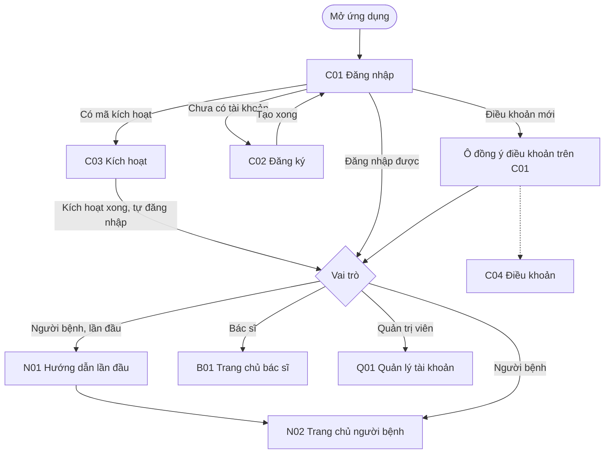
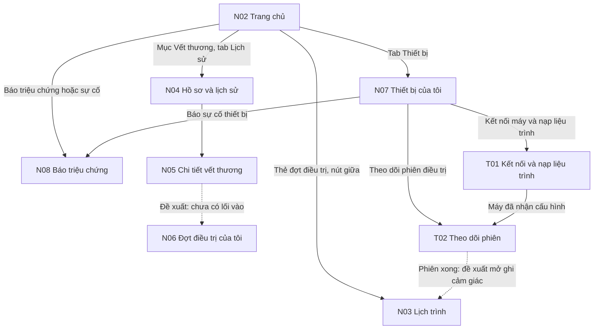
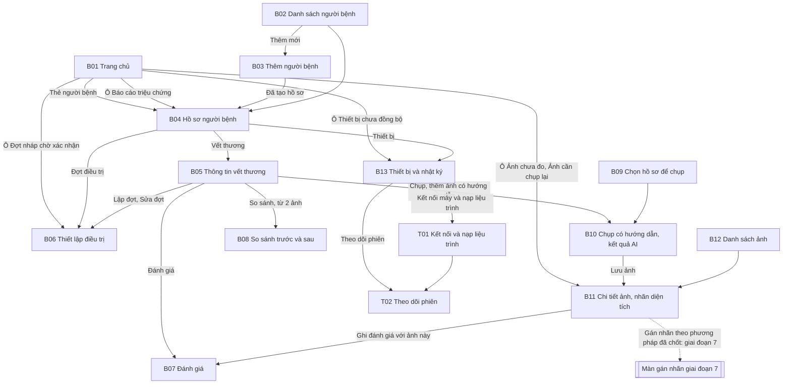
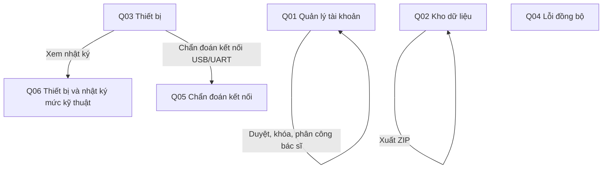
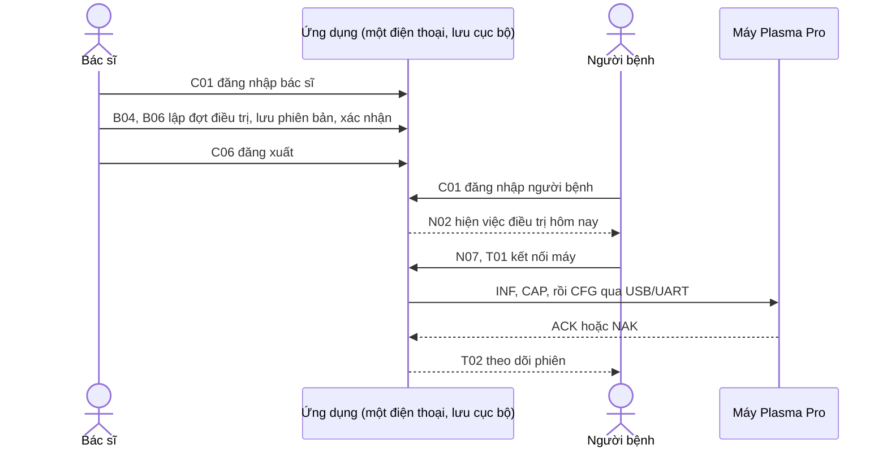

# Giai đoạn 5.2. Sơ đồ luồng màn hình theo vai trò

Trạng thái: **bản nháp** (11/11/2026). Mã màn lấy từ [giao-dien-01-danh-sach-man.md](giao-dien-01-danh-sach-man.md). Mũi tên lấy từ các lệnh `router.push`, `router.replace`, `Redirect` và thanh tab trong `src/app/` và `src/components/` (nhánh `trien-khai/giai-doan-2`, commit `a2719c8`). Mũi tên nét đứt là luồng đề xuất, chưa có trong mã.

## 1. Vào ứng dụng (mọi vai trò)

Mọi màn trong nhóm vai trò kiểm `me.role`; sai vai trò thì về C01 (`RoleTabs`). Màn C06 Tài khoản ở tab cuối của cả ba vai trò, dẫn tới C04, C05, N01 (xem lại) và Đăng xuất (về C01).

## 2. Người bệnh

Thanh tab: Trang chủ (N02), Lịch sử (N04), nút giữa Lịch trình (N03), Thiết bị (N07), Tài khoản (C06).

Luồng chính tại nhà (một buổi điều trị):

1. N02 cho biết hôm nay có cần chiếu không (FR1) và các việc trước khi chiếu.
2. Cắm cáp USB OTG từ điện thoại vào máy, mở N07, bấm "Kết nối máy và nạp liệu trình" để vào T01.
3. T01 kết nối, hỏi thông tin máy, hiện cấu hình sẽ gửi, gửi xuống máy (FR2). Lỗi ở bước này xử lý theo [giao-dien-03-wireframe.md](giao-dien-03-wireframe.md), mục T01.
4. Máy nhận cấu hình thì sang T02. Người bệnh bấm nút trên máy; T02 hiện thời gian còn lại theo bản tin `STA`.
5. Phiên xong, người bệnh ghi cảm giác ở N03 (FR6). Mũi tên T02 sang N03 là đề xuất; hiện người bệnh tự quay về N03.

N06 có chế độ xem cho người bệnh trong `plan/[patientId].tsx` nhưng không màn nào của người bệnh dẫn tới (chỉ B01, B04, B05 có `router.push` tới tệp này). Thông tin đợt điều trị người bệnh cần đã hiện ở N02, N03 và thẻ đợt trong N05. Đề xuất: hoặc thêm lối vào từ thẻ đợt ở N05, hoặc bỏ chế độ xem người bệnh của N06.

## 3. Bác sĩ

Thanh tab: Trang chủ (B01), Bệnh nhân (B02), nút giữa Chụp ảnh (B09), Ảnh (B12), Tài khoản (C06).

Nút L7 chỉ giữ chỗ. Cách gán nhãn (phân loại, khung, phân vùng) thuộc giai đoạn 7 và chờ bác sĩ chốt (FR15).

## 4. Quản trị viên

Thanh tab: Tài khoản (Q01), Dữ liệu (Q02), Thiết bị (Q03), Lỗi (Q04), Cá nhân (C06).

Quản trị viên không vào được T01, T02 và các màn lâm sàng (`useCanView` trả về sai cho vai trò admin). Q05 là nơi duy nhất xem byte gửi và nhận, đổi giữa USB thật và thiết bị giả lập.

## 5. Luồng demo trên một máy: bác sĩ gửi liệu trình cho người bệnh

Theo quyết định ngày 11/11/2026, luồng này chỉ demo trên một điện thoại, đăng nhập lần lượt từng vai trò. Đồng bộ giữa hai điện thoại để sau khi có backend và cơ sở dữ liệu ([de-xuat-backend.md](de-xuat-backend.md)).

Giả định: dữ liệu bác sĩ lưu ở bước 2 nằm trong bộ nhớ cục bộ (AsyncStorage) của cùng điện thoại, nên người bệnh thấy ngay sau khi đăng nhập. Khi có máy chủ, bước "đăng xuất, đăng nhập" thay bằng đồng bộ.

## Tài liệu tham khảo

1. Mã nguồn `mducnguyen610/PlasmaProApp`, nhánh `trien-khai/giai-doan-2`, commit `a2719c8`: `src/components/RoleTabs.tsx`, `src/app/*/_layout.tsx`, `src/components/Guard.tsx`.
2. [10-thiet-ke-chi-tiet.md](10-thiet-ke-chi-tiet.md), mục 10.1 và 10.2 (máy trạng thái kết nối và phiên).
